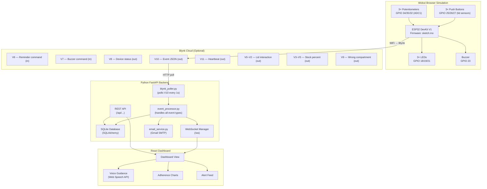

# System Architecture — MediBridge IoT

## Full Architecture Diagram



---

## Component Responsibilities

| Component | File(s) | Responsibility |
|-----------|---------|----------------|
| ESP32 Firmware | `circuit/sketch.ino` | Read sensors, detect events, encode JSON, send to Blynk V10 |
| Config (non-secret) | `circuit/medibridge_config.h` | Pin map, thresholds, timings |
| Logic library | `circuit/medibridge_logic.h` | Stock tracker, debouncer, event JSON builder (testable, no Arduino deps) |
| Blynk poller | `backend/services/blynk_poller.py` | Poll V10 every 1 s, deduplicate by event_id, dispatch to event processor |
| Event processor | `backend/services/event_processor.py` | Handle each event type, update DB, broadcast WebSocket, trigger alerts |
| Alert service | `backend/services/alert_service.py` | Apply severity rules, create alert records |
| Email service | `backend/services/email_service.py` | Send caregiver emails via Gmail SMTP with retry |
| WebSocket manager | `backend/services/websocket_manager.py` | Maintain connected clients, broadcast JSON messages |
| REST API | `backend/routers/*.py` | CRUD for all entities; write Blynk pins for reminders/buzzer |
| React frontend | `frontend/src/` | Real-time dashboard, charts, accessibility, voice guidance |

---

## Data Flow: Event Lifecycle

```
1. Patient presses button (lid opens)
        │
        ▼
2. ESP32 debounces, classifies (expected / wrong_compartment / no_reminder)
        │
        ▼
3. emitEvent() builds compact JSON ≤ 256 bytes, prints to Serial
        │
        ├─ [offline] → Serial Monitor only
        └─ [cloud]   → queued → Blynk.virtualWrite(V10, json)
                               │
                               ▼
                       4. Backend polls V10 every 1 s
                               │
                               ▼
                       5. event_processor.py:
                          • INSERT INTO events
                          • UPDATE compartments table
                          • Broadcast via WebSocket → frontend updates
                          • Apply alert rules → INSERT INTO alerts
                          • wrong_compartment / reminder_missed / stock_empty
                            → INSERT INTO notifications → send email
```

---

## WebSocket Real-Time Flow

```
Backend WebSocket /ws
        │
        │  JSON messages:
        │  {"type": "event",       "data": {...}}
        │  {"type": "alert",       "data": {...}}
        │  {"type": "compartment", "data": {...}}
        │  {"type": "heartbeat",   "ts":  "..."}
        │
        ▼
React frontend (useWebSocket hook)
  → updates compartment cards
  → appends to alert feed
  → triggers voice announcement
  → updates stock bars
```

---

## Database Schema (SQLite)

```
patients ──< caregivers
    │
    └──< devices ──< compartments ──< schedules
                         │
                         └──< events ──< alerts ──< notifications
                                │
                                └──< medicines
```

---

## Blynk Virtual Pin Map

| Pin | Direction | Name | Type | Range | Description |
|-----|-----------|------|------|-------|-------------|
| V0 | Out | Lid Interaction 1 | Integer | 0–1 | 1 when compartment 1 opened |
| V1 | Out | Lid Interaction 2 | Integer | 0–1 | 1 when compartment 2 opened |
| V2 | Out | Lid Interaction 3 | Integer | 0–1 | 1 when compartment 3 opened |
| V3 | Out | Stock Percent 1 | Integer | 0–100 | Compartment 1 stock % |
| V4 | Out | Stock Percent 2 | Integer | 0–100 | Compartment 2 stock % |
| V5 | Out | Stock Percent 3 | Integer | 0–100 | Compartment 3 stock % |
| V6 | In | Reminder Command | Integer | 0–3 | 0=cancel, 1/2/3=start reminder |
| V7 | In | Buzzer Command | Integer | 0–1 | 0=mute, 1=test beep |
| V8 | Out | Device Status | String | — | "online fw=1.0.0" |
| V9 | Out | Wrong Compartment | Integer | 1–3 | ID of wrong compartment pressed |
| V10 | Out | Event JSON | String | ≤256B | Full event payload (backend polls this) |
| V11 | Out | Heartbeat | Integer | — | Uptime seconds (every 5 min) |
