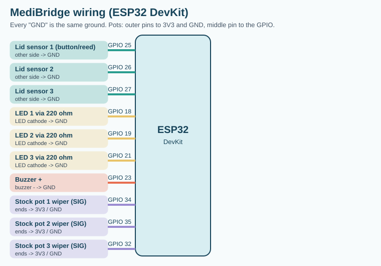

# Pin mapping

| Function | ESP32 pin | Part (Wokwi id) | Notes |
|---|---|---|---|
| Lid sensor 1 | GPIO 25 | `btn1` pushbutton | other leg to GND, `INPUT_PULLUP`, pressed = LOW = "opened" |
| Lid sensor 2 | GPIO 26 | `btn2` | same |
| Lid sensor 3 | GPIO 27 | `btn3` | same |
| LED 1 | GPIO 18 | `led1` + `r1` 220 Ω | GPIO → resistor → LED anode, cathode → GND (~5 mA) |
| LED 2 | GPIO 19 | `led2` + `r2` | same |
| LED 3 | GPIO 21 | `led3` + `r3` | same |
| Buzzer | GPIO 23 | `bz1` | `+` to GPIO, `-` to GND. Driven with PWM tones |
| Stock 1 | GPIO 34 | `pot1` | wiper (SIG) to GPIO, outer pins to 3V3 and GND. ADC1, input-only |
| Stock 2 | GPIO 35 | `pot2` | same |
| Stock 3 | GPIO 32 | `pot3` | same, ADC1 |

## Why these pins are safe
* None is a boot-strapping pin (0, 2, 5, 12, 15).
* GPIO 34/35 are input-only → used only as ADC inputs. They have no internal pull-ups, which a potentiometer does not need.
* Stock inputs are on **ADC1**. ADC2 pins stop working while WiFi is on.
* Pots are powered from **3V3**, never 5 V, so the ADC pin never sees more than 3.3 V.
* LED current ≈ (3.3 − ~2 V) / 220 Ω ≈ 5 mA, below the ESP32 per-pin limit.

## Real hardware notes (not simulated)
* Passive piezo buzzer: fine from a GPIO. **Active or louder buzzers (>12 mA) need a transistor** (e.g. 2N2222 + 1 kΩ base resistor) — do not drive them directly.
* Reed switch: usually wired GPIO → switch → GND. If it is *closed* while the lid is shut, flip `MB_SENSOR_ACTIVE_LEVEL` in `medibridge_config.h`.
* Wire long runs with a series 1 kΩ resistor on inputs, and add a 0.1 µF capacitor across each reed switch if you see false triggers.
* The pin list lives in ONE place: `circuit/medibridge_config.h`.
